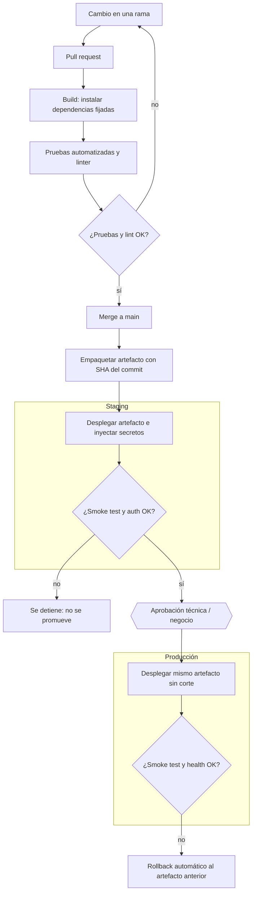

# Mapa de estrategia CI/CD - API de tareas

> Autor o autora: joshua 
> Punto de partida: `docs/DESPLIEGUE_MANUAL.md`, el proceso manual que el pipeline va a reemplazar.
> Cómo se ve un mapa terminado: `docs/ejemplo-mapa-cicd-sitio.md` (otro caso, mismo método).
> Sintaxis de los diagramas: la Guía rápida de Mermaid (Moodle, material de apoyo).

## 1. Flujo de commit a producción

## 2. Ambientes

| Ambiente | Para qué sirve | Cómo llega un cambio | Quién decide que llegue |
|---|---|---|---|
| | | | |

## 3. Riesgos del proceso manual y controles

Un renglón por riesgo. La columna "Paso" cita el paso de `DESPLIEGUE_MANUAL.md`.

| Paso | Riesgo | Qué puede pasar | Control del pipeline que lo atiende | Etapa del flujo |
|---|---|---|---|---|
| | | | | |

## 4. Criterios de éxito

Qué tiene que ser verdad para decir que un despliegue salió bien, de forma que una máquina lo
pueda comprobar.

-

## 5. Decisiones y preguntas abiertas

-
Uso de IA: Se utilizó IA como apoyo para estructurar el diagrama Mermaid y redactar las tablas a partir del análisis de riesgos del documento de despliegue manual